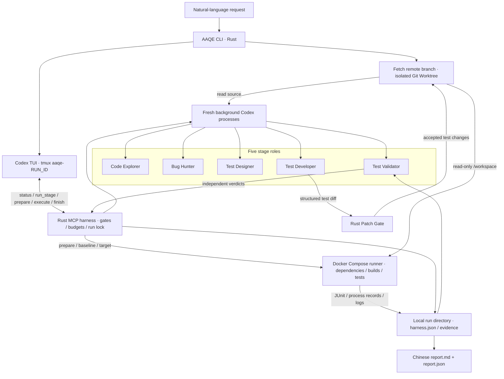

# AAQE

**AI Agent Quality Engineering** — Describe a product or module to inspect. AAQE coordinates Codex agents to investigate code, develop tests and validate findings in Docker, with a retained environment and traceable evidence.

English · [简体中文](README.zh-CN.md)

```text
Your request → Codex coordinator ↔ Rust MCP harness → independent stage agents
                                         ↓
                             protected test patch → Docker → evidence + report
```

## Install

Install from source with Rust **1.88+** and Cargo:

```bash
git clone https://github.com/qevolg/ai-agent-qe.git
cd ai-agent-qe
cargo install --path . --locked
aaqe doctor
```

Keep `~/.cargo/bin` in `PATH`. Alternatively, run `cargo build --release --locked` and copy `target/release/aaqe` to a directory in `PATH`. The executable embeds its five stage roles, Skills and schemas; it can run outside the source checkout without a Python package or virtual environment.

| Runtime requirement | Purpose |
| --- | --- |
| Linux or WSL2 | Run AAQE, tmux and Codex in the same environment; native Windows is unsupported |
| Git and a reachable remote | Fetch the configured branch and create an isolated audit Worktree |
| tmux | Keep one interactive coordinator terminal per audit; on Debian/Ubuntu: `sudo apt-get install tmux` |
| Authenticated Codex CLI | Must support `--no-alt-screen --no-daemon`, stdio MCP and `exec --ephemeral --sandbox read-only --output-schema --output-last-message`; transport previously validated with 0.172.0 |
| Docker daemon and Compose v2+ | Build and test the audited product in Linux containers |

Git, tmux and Codex run on the host. Product dependencies, builds, fixtures and tests run inside Docker; the host does not need the audited project's Java, Maven, Python, Node, Rust or test framework. Source installation and AAQE's own development tests have separate prerequisites below.

If upgrading from the former Python implementation, uninstall it with `python3 -m pip uninstall ai-agent-qe`, install the Rust executable and check `command -v aaqe`. Saved runs remain compatible with reporting, reproduction and cleanup.

## Features

- **Prompt-driven scope:** inspect a product or module without a predefined target name; report examined and uncovered areas.
- **Independent stages:** Code Explorer, Bug Hunter, Test Designer, Test Developer and Test Validator each run in a fresh background Codex process.
- **Persistent coordinator:** attach to one live Codex TUI during the audit and ask follow-up questions after the report is saved.
- **Protected production code:** Rust checks returned test patches before applying them; product assertion failures remain evidence.
- **Real execution evidence:** baseline and target runs, exact JUnit case matching, source references and per-attempt logs support independent verdicts.
- **Retained environments:** replay saved tests without another AI invocation, then explicitly clean only the run's owned resources.

## Architecture



The coordinator chooses the next stage; Rust enforces dependencies, budgets, patch rules and evidence gates. Stages can be retried or revisited. Accepted upstream revisions invalidate current downstream artifacts and verdicts while preserving history. Audits finish only through the MCP `finish` operation. The outer command then returns and the coordinator TUI stays available.

## Quick start

Run from the root of the Git project you want to inspect:

```bash
cd /path/to/product
aaqe
```

Enter a request, or supply it directly:

```bash
aaqe run "Inspect the import module, focusing on recovery and duplicate writes; add reproducible tests"
```

By default, AAQE fetches **`origin/main`** and creates `aaqe/<RUN_ID>` from that fetched commit. The current branch and uncommitted product changes are excluded. Fetch failure does not silently use old code. The project supplies business expectations, interfaces and version requirements; AAQE has no built-in product-specific oracle.

Configuration is optional. With no `aaqe.yaml`, the coordinator and Explorer discover environment and test entry points from repository evidence. Unavailable prerequisites or behavioral evidence produce a blocked result.

### Attach to the coordinator

Each new run uses `YYYYMMDDHHmmss-xxxxxxxx`: the timestamp is in **Asia/Shanghai (UTC+08:00)** and the suffix is eight random hexadecimal characters. For example:

```bash
tmux attach-session -t aaqe-20261125081514-ab12cd34
```

Use the actual command printed by AAQE. In an existing tmux client, use `tmux switch-client -t SESSION`. Detach with the tmux prefix followed by `d` (default: `Ctrl+b`, then `d`). Native Codex folder-trust or login prompts may require interaction in this terminal; AAQE does not change your global trust settings.

The audit timeout stops applying after a successful `finish`. During an audit, interruption or coordinator exit cancels active stage workers and saves partial results. Timestamp records carry `+08:00`; historical records retain their original names and offsets.

## Commands

```text
aaqe [--config PATH] [--state-dir PATH] [COMMAND]
```

| Command | Arguments and behavior |
| --- | --- |
| `aaqe` | Read an audit request interactively and start a run |
| `aaqe run [PROMPT]` | Start from one quoted request; omit `PROMPT` to enter it interactively |
| `aaqe doctor` | Check Git, configured Codex, tmux, Docker daemon and Compose |
| `aaqe report RUN_ID` | Print the saved report; current-format reports are rebuilt from the authoritative snapshot |
| `aaqe reproduce RUN_ID [--case TEST_ID]` | Replay all saved tests, or one selected test, in the retained environment |
| `aaqe cleanup RUN_ID` | Remove owned Docker resources and tmux sessions; retain reports, logs, branch and Worktree |
| `aaqe env status RUN_ID` | Show the retained Compose environment's status |
| `aaqe env shell RUN_ID [--service SERVICE]` | Open `sh` in a service; default: the run's `runner_service` |
| `aaqe help [COMMAND]` | Show help, including nested commands such as `aaqe help env shell` |

| Option | Scope and default |
| --- | --- |
| `--config PATH` | Global; default: `./aaqe.yaml` in the command's working directory |
| `--state-dir PATH` | Global; overrides YAML `state_dir`; default: `~/.aaqe/runs` |
| `--case TEST_ID` | `reproduce` only; omit to replay all saved tests |
| `--service SERVICE` | `env shell` only; omit to use the saved Runner |
| `-h`, `--help` | Top-level or subcommand help |
| `-V`, `--version` | Top-level version |

Global options can appear before or after the subcommand. A relative CLI path uses the invocation directory. Models, remote branches and timeouts are configured in YAML. Internal `__*` worker commands are implementation entry points.

Exit codes: `0` means the command succeeded (a completed audit can contain confirmed defects or blocked candidates); `1` means the audit did not complete, a doctor check failed or an environment status command failed; `2` means invalid arguments or an operation error. `env shell` propagates the container shell's exit status. Reproduction prints execution records; inspect their exit codes/JUnit results to determine test outcomes.

## Configuration

**Where is `aaqe.yaml`?** AAQE does not create it during installation. It reads only `aaqe.yaml` in the **directory where you invoke the command**, without searching parent directories. An absent default file uses built-in settings; an explicitly specified missing `--config` file is an error.

Start from the annotated [aaqe.yaml.example](aaqe.yaml.example), copy it into the audited project and fill in project-specific fields. A runnable Python/Compose example is available at [examples/minimal/](examples/minimal/README.md), including its own [aaqe.yaml](examples/minimal/aaqe.yaml). That example must live in a separate Git repository and be committed to its remote branch.

```bash
# Use a configuration at a fixed location.
aaqe --config /path/to/product/aaqe.yaml run "Inspect error recovery"

# Use the same state directory for later operations.
aaqe --state-dir /path/to/runs report 20261125081514-ab12cd34
```

| YAML field | Default | Meaning |
| --- | --- | --- |
| `state_dir` | `~/.aaqe/runs` | Run records, Worktrees and evidence |
| `git.remote` | `origin` | Remote to fetch |
| `git.branch` | `main` | Remote branch used as the audit baseline |
| `codex.command` | `[codex]` | Codex executable and fixed leading arguments |
| `codex.model` | unset | Model override; otherwise use Codex's configuration |
| `references` | `[]` | Project behavior/interface reference paths |
| `baseline` | `[]` | Trusted global baseline argv lists; when nonempty, take precedence over per-test/Explorer baselines |
| `test_paths` | `tests/**`, `test/**`, `**/tests/**`, `**/test/**`, `.aaqe/tests/**` | Paths allowed for test patches |
| `timeouts.agent` | `1800` | Seconds per independent stage call |
| `timeouts.test` | `1200` | Seconds per test process |
| `timeouts.docker` | `1200` | Docker operation timeout in seconds |
| `loop.max_stage_calls` | `20` | Stage-call budget; environment actions plus execution attempts have a separate budget of the same size |
| `loop.max_stage_attempts` | `4` | Maximum attempts per role |
| `loop.timeout` | `14400` | Seconds from coordinator start to audit finish; excludes later TUI interaction |

Environment fields are optional project inputs; the coordinator can discover or propose them when absent:

| `environment` field | Default / behavior |
| --- | --- |
| `compose_files` | Project Compose paths; cannot coexist with nonempty inline `compose` |
| `compose` | Inline Compose object or a JSON-encoded object; saved outside the product Worktree |
| `services` | Additional owned services to start; the Runner is always included |
| `runner_service` | Persistent test container, required before execution |
| `runner_workdir` | `/workspace` |
| `readiness_timeout` | `180` seconds for Compose health waiting, also subject to the operation deadline |
| `readiness` | `[]`; argv probes run inside the Runner after Compose readiness |
| `setup` | `[]`; idempotent dependency-install argv lists, run as user `0` before readiness |
| `external_containers` | `[]`; existing containers inspected without taking ownership |
| `env_file` | Optional private env-file path; resolved relative to the configuration file |

Configuration is read before creating the audit Worktree, so an uncommitted local configuration can be used. Source/reference/Compose paths refer to the new Worktree. Relative YAML `state_dir` and `env_file` refer to the configuration directory. Environment precedence is project YAML, then explicit preparation input, then Explorer inference. Unknown YAML fields are rejected. Keep credentials in private files or environment variables.

For dependency recovery, inline Compose, per-test baselines, probes, MCP budgets and exact replay rules, see the [detailed runtime reference (Chinese)](docs/runtime.md).

## Reports, reproduction and cleanup

The default record directory is `~/.aaqe/runs/<RUN_ID>/`. Branches use `aaqe/<RUN_ID>`; Docker projects and coordinator sessions use `aaqe-<RUN_ID>`. Old IDs and legacy tmux names remain readable and cleanable.

| Artifact | Contents |
| --- | --- |
| `harness.json` | Versioned authoritative snapshot: state, active artifacts, execution and verdicts |
| `run.json`, `execution.json`, `artifacts/` | Compatibility/derived outputs; current-format reports can be reconstructed |
| `operation.lock` | Per-run exclusion for MCP, report, reproduction and cleanup |
| `stages/coordinator/` | Prompt, `tmux.json`, terminal output and MCP tool history |
| `stages/<role>/`, `stages/<role>/attempts/0002/` | Independent stage attempts, structured artifacts and process logs |
| `environment/` | Compose snapshot, ownership, readiness, dependency setup and probes |
| `executions/<attempt>/`, `executions/rounds/<id>/` | Test/baseline evidence and selected execution rounds |
| `reproductions/<id>/` | Replay journal, preparation results, completed cases and failures |
| `report.md`, `report.json` | Chinese human-readable report and machine-readable evidence |

Markdown reports start with a summary table, then cover conclusions, scope/progress, environment/evidence, results, issue records, path changes, limitations and retained-environment replay. Natural-language stage fields are requested in Simplified Chinese. JSON keys/enums, code, commands and original evidence remain unchanged. Legacy free text is preserved.

Verdicts are `confirmed` (a valid assertion demonstrates a defect), `not_reproduced`, `blocked`, `invalid_test` or `flaky`. A command exit code alone cannot confirm a product bug: baseline health, complete matching JUnit evidence and independent validation are required. Empty analyzed scope is distinguished from missing analysis; retry and reproduction history are excluded from current-result counts.

```bash
aaqe report RUN_ID
aaqe env status RUN_ID
aaqe env shell RUN_ID --service runner
aaqe reproduce RUN_ID --case TEST_ID
aaqe cleanup RUN_ID
```

Reproduction verifies the recorded base commit, restores the Runner and saved dependency recipe, and journals each step without replacing original verdicts. Cleanup validates resource ownership and the Compose snapshot, closes the coordinator, and preserves evidence, branch and Worktree. It also supports repeated cleanup and legacy sessions. Active audits or concurrent operations are rejected. Run files may contain private source, resolved environment values and logs; they stay local.

## Project structure

| Path | Responsibility |
| --- | --- |
| `src/cli.rs`, `src/config.rs` | Commands and validated configuration |
| `src/harness*`, `src/mcp.rs` | Audit state machine, gates, MCP and recovery |
| `src/codex.rs`, `src/tmux.rs`, `src/process.rs` | Codex transport, retained TUI and supervised processes |
| `src/patchgate.rs`, `src/evidence.rs` | Production-code protection and JUnit checks |
| `src/environment*`, `src/workflow.rs` | Docker execution, reproduction and cleanup |
| `src/state*`, `src/reporting.rs` | Snapshots, locks, run names and reports |
| `src/resources/` | Embedded roles, Skills and schemas |
| `tests/`, `examples/minimal/` | Regression/integration tests and a runnable external-project example |

## Development

```bash
cargo fmt --all -- --check
cargo clippy --locked --all-targets -- -D warnings
cargo test --locked --all-targets
cargo build --locked --release
cargo package --locked --allow-dirty --target-dir target/package-check
```

The ordinary suite uses real temporary Git repositories and tmux sessions with deterministic Codex/Docker boundary fixtures. It needs tmux and Python 3 for fixtures. The opt-in integration test uses real Docker containers and deterministic model responses:

```bash
cargo test --locked --test workflow real_docker_workflow_reproduction_and_owned_cleanup -- --ignored --nocapture
```

It covers file/inline Compose, readiness and dependency repair, protected patches, baseline/target execution, JUnit, selected reruns, reproduction and owned cleanup. These fixtures validate orchestration; they do not establish an actual-model business-product audit. See [validation records](docs/validation.md) for evidence and limits.

## License

[MIT](LICENSE). Copyright (c) 2026 qevolg.
