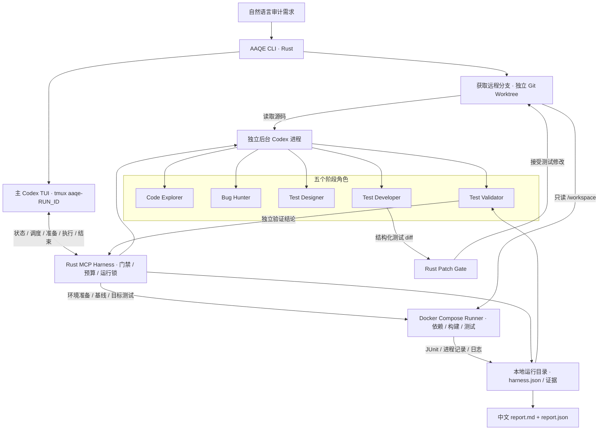

# AAQE

**AI Agent Quality Engineering** — 用自然语言描述需要检查的产品或模块。AAQE 调度 Codex 分析代码、编写测试，在 Docker 中验证问题，并保留环境和可追溯的证据。

[English](README.md) · 简体中文

```text
审计需求 → 主 Codex TUI ↔ Rust MCP Harness → 独立阶段 Agent
                                  ↓
                        受检查的测试补丁 → Docker → 证据与报告
```

## 安装

使用 Rust **1.88+** 和 Cargo 从源码安装：

```bash
git clone https://github.com/qevolg/ai-agent-qe.git
cd ai-agent-qe
cargo install --path . --locked
aaqe doctor
```

确保 `~/.cargo/bin` 位于 `PATH`。也可以运行 `cargo build --release --locked`，将 `target/release/aaqe` 复制到 `PATH` 中的目录。可执行文件内嵌五个阶段的角色、Skill 和 Schema，可脱离源码目录运行，无需 Python 包或虚拟环境。

| 运行依赖 | 用途 |
| --- | --- |
| Linux 或 WSL2 | AAQE、tmux、Codex 在同一环境中运行；不支持原生 Windows |
| Git 与可访问的远程仓库 | 获取指定远程分支并创建独立审计 Worktree |
| tmux | 每轮保留一个交互式主窗口；Debian/Ubuntu 可用 `sudo apt-get install tmux` 安装 |
| 已登录的 Codex CLI | 需要支持 `--no-alt-screen --no-daemon`、stdio MCP 以及 `exec --ephemeral --sandbox read-only --output-schema --output-last-message`；此前传输验证版本为 0.172.0 |
| Docker daemon 与 Compose v2+ | 在 Linux 容器中构建、测试被审计项目 |

Git、tmux 和 Codex 在宿主机运行。被审计项目的依赖、构建、fixture 和测试全部在 Docker 内执行，宿主机无需安装该项目所需的 Java、Maven、Python、Node、Rust 或测试框架。源码安装以及 AAQE 自身开发测试的依赖另见文末。

旧 Python 版用户可先运行 `python3 -m pip uninstall ai-agent-qe`，再安装 Rust 版，并用 `command -v aaqe` 检查入口。已有运行记录继续支持查看报告、复现和清理。

## 功能

- **自然语言确定范围**：按需求检查整个产品或指定模块，记录已检查和未覆盖区域。
- **独立阶段执行**：Code Explorer、Bug Hunter、Test Designer、Test Developer、Test Validator 每次都使用新的后台 Codex 进程。
- **保留交互主窗口**：审计期间可以 attach 查看，报告完成后仍可追问和复现。
- **保护生产代码**：Rust 检查返回的测试补丁后才应用，保留产品断言失败作为证据。
- **真实执行证据**：基线与目标测试、精确 JUnit 用例匹配、源码引用和每次尝试的日志支撑独立判断。
- **保留环境**：无需再次调用 AI 即可重跑保存的测试，再显式清理本轮拥有的资源。

## 架构



主调度决定下一步阶段，Rust 检查依赖、预算、测试补丁和执行证据。主窗口可重试阶段或回到上游；重新接受上游结果后，下游有效产物及结论失效，历史记录保留。审计必须通过 MCP `finish` 显式结束，随后外层命令返回，主 TUI 继续等待输入。

## 快速开始

进入需要检查的 Git 项目根目录：

```bash
cd /path/to/product
aaqe
```

交互输入需求，或直接传入：

```bash
aaqe run "检查数据导入模块，重点验证错误恢复和重复写入，补充可复现的测试"
```

默认获取 **`origin/main`**，从本次获取的提交创建 `aaqe/<RUN_ID>` 分支。当前分支和未提交的产品修改不会带入审计；网络失败不会静默使用旧代码。业务预期、接口和版本要求由项目提供，AAQE 不内置特定产品的行为约定。

`aaqe.yaml` 可选。没有配置时，主调度和 Explorer 根据仓库证据发现环境与测试入口；缺少运行条件或可靠行为依据时保留 blocked 原因。

### 连接主调度窗口

每轮编号格式为 `YYYYMMDDHHmmss-xxxxxxxx`，时间使用 **Asia/Shanghai（UTC+08:00）**，后缀为八位随机十六进制字符。例如：

```bash
tmux attach-session -t aaqe-20261125081514-ab12cd34
```

实际使用 AAQE 打印的连接命令。已经处于 tmux 内时用 `tmux switch-client -t SESSION`。默认按 `Ctrl+b` 再按 `d` 分离窗口。Codex 的目录信任、登录等原生提示可能需要在该窗口中处理，AAQE 不修改全局信任设置。

成功 `finish` 后，本轮审计超时不再限制 TUI 交互。审计期间中断或主窗口退出会取消仍在执行的阶段并保存部分结果。新时间记录带 `+08:00` 偏移，历史编号和原时间值继续保留。

## 命令

```text
aaqe [--config PATH] [--state-dir PATH] [COMMAND]
```

| 命令 | 参数与行为 |
| --- | --- |
| `aaqe` | 交互输入需求并启动审计 |
| `aaqe run [PROMPT]` | 传入一段带引号的需求；省略时交互输入 |
| `aaqe doctor` | 检查 Git、配置的 Codex、tmux、Docker daemon 和 Compose |
| `aaqe report RUN_ID` | 输出已保存报告；当前格式从权威快照重建 |
| `aaqe reproduce RUN_ID [--case TEST_ID]` | 重跑全部保存的测试，或指定一个测试 |
| `aaqe cleanup RUN_ID` | 清理本轮拥有的 Docker 资源与 tmux 会话，保留报告、日志、分支和 Worktree |
| `aaqe env status RUN_ID` | 查看保留的 Compose 环境状态 |
| `aaqe env shell RUN_ID [--service SERVICE]` | 进入指定服务的 `sh`，默认使用本轮 `runner_service` |
| `aaqe help [COMMAND]` | 查看帮助，支持 `aaqe help env shell` 等多层命令 |

| 参数 | 适用范围与默认值 |
| --- | --- |
| `--config PATH` | 全局；默认读取执行命令时所在目录的 `./aaqe.yaml` |
| `--state-dir PATH` | 全局；覆盖 YAML 的 `state_dir`，默认 `~/.aaqe/runs` |
| `--case TEST_ID` | 仅 `reproduce`；省略时重跑全部保存的测试 |
| `--service SERVICE` | 仅 `env shell`；省略时进入保存的 Runner |
| `-h`、`--help` | 查看顶层或子命令帮助 |
| `-V`、`--version` | 查看顶层命令版本 |

全局参数可以放在子命令前或后。命令行相对路径以调用目录为准。模型、远程分支和超时通过 YAML 配置；内部 `__*` 命令用于启动工作进程。

退出码：`0` 表示命令成功，审计 completed 仍可能包含已确认缺陷或受阻候选；`1` 表示审计未完成、doctor 检查失败或环境状态查询失败；`2` 表示参数或操作错误。`env shell` 透传容器 shell 的退出码。复现命令输出执行记录，实际测试结果需查看记录中的退出码和 JUnit。

## 配置

**`aaqe.yaml` 在哪里？** 安装不会自动生成配置。默认只读取**运行命令时所在目录**下的 `aaqe.yaml`，不向上查找仓库根目录。默认文件不存在时使用内置值；显式 `--config` 指定的文件不存在时会报错。

根目录提供带中文注释的 [aaqe.yaml.example](aaqe.yaml.example)，可复制到被审计项目并按需填写。完整的 Python/Compose 最小示例在 [examples/minimal/](examples/minimal/README.md)，配置见其 [aaqe.yaml](examples/minimal/aaqe.yaml)。运行该示例前需复制到独立 Git 仓库，并提交到远程分支。

```bash
# 显式指定配置文件。
aaqe --config /path/to/product/aaqe.yaml run "检查错误恢复"

# 后续操作继续使用相同运行目录。
aaqe --state-dir /path/to/runs report 20261125081514-ab12cd34
```

| YAML 字段 | 默认值 | 含义 |
| --- | --- | --- |
| `state_dir` | `~/.aaqe/runs` | 运行记录、Worktree 和证据目录 |
| `git.remote` | `origin` | 获取代码的远程仓库 |
| `git.branch` | `main` | 本轮审计基准使用的远程分支 |
| `codex.command` | `[codex]` | Codex 可执行命令与固定前置参数数组 |
| `codex.model` | 不指定 | 覆盖模型；省略时使用 Codex 自身配置 |
| `references` | `[]` | 项目行为、接口等参考文件路径 |
| `baseline` | `[]` | 受信任的全局基线 argv 列表；非空时优先于每测试或 Explorer 基线 |
| `test_paths` | `tests/**`、`test/**`、`**/tests/**`、`**/test/**`、`.aaqe/tests/**` | 允许测试补丁修改的路径 |
| `timeouts.agent` | `1800` | 每次独立阶段调用的秒数上限 |
| `timeouts.test` | `1200` | 每条测试进程的秒数上限 |
| `timeouts.docker` | `1200` | Docker 操作的秒数上限 |
| `loop.max_stage_calls` | `20` | 阶段调用预算；环境动作与执行尝试另有同样大小的独立预算 |
| `loop.max_stage_attempts` | `4` | 每种角色最多尝试次数 |
| `loop.timeout` | `14400` | 主调度启动至审计结束的秒数上限，不限制结束后的 TUI 交互 |

环境字段均为可选的项目输入，未指定时可由主调度发现或提出：

| `environment` 下的字段 | 默认值／行为 |
| --- | --- |
| `compose_files` | 项目 Compose 路径，不能与非空 inline `compose` 同时使用 |
| `compose` | inline Compose 对象或该对象的 JSON 字符串，写在产品 Worktree 之外 |
| `services` | 需要启动的其他本轮服务；Runner 始终包含在内 |
| `runner_service` | 持续运行的测试容器，执行前必须确定 |
| `runner_workdir` | `/workspace` |
| `readiness_timeout` | Compose 等待健康的默认秒数为 `180`，同时受操作期限限制 |
| `readiness` | `[]`；Compose 就绪后在 Runner 内执行的 argv 探针 |
| `setup` | `[]`；幂等依赖安装 argv 列表，就绪检查前以用户 `0` 执行 |
| `external_containers` | `[]`；仅检查已存在容器，不接管其所有权 |
| `env_file` | 可选私有环境文件，以配置文件目录为基准解析 |

配置在创建审计 Worktree 前读取，可使用本地未提交的操作配置。源码、参考文件和 Compose 路径指向新 Worktree；YAML 中相对 `state_dir`、`env_file` 以配置文件目录解析。环境字段优先级为项目 YAML、显式准备参数、Explorer 推断。未知 YAML 字段会被拒绝。凭据放在私有文件或环境变量中。

容器依赖恢复、inline Compose、每测试基线、探测、MCP 预算及精确复现规则见[详细运行机制](docs/runtime.md)。

## 报告、复现与清理

默认运行目录为 `~/.aaqe/runs/<RUN_ID>/`；分支为 `aaqe/<RUN_ID>`，Docker 项目和主 tmux 会话为 `aaqe-<RUN_ID>`。旧编号和旧 tmux 名称继续支持读取与清理。

| 产物 | 内容 |
| --- | --- |
| `harness.json` | 带版本的权威快照：运行状态、当前有效产物、执行与判定 |
| `run.json`、`execution.json`、`artifacts/` | 兼容或派生输出；当前格式报告可以重建 |
| `operation.lock` | 同一运行的 MCP、报告、复现、清理操作互斥 |
| `stages/coordinator/` | 提示词、`tmux.json`、终端输出和 MCP 调用历史 |
| `stages/<role>/`、`stages/<role>/attempts/0002/` | 独立阶段尝试、结构化产物与进程日志 |
| `environment/` | Compose 快照、资源归属、就绪、安装配方和探测 |
| `executions/<attempt>/`、`executions/rounds/<id>/` | 测试和基线证据、选中测试重跑轮次 |
| `reproductions/<id>/` | 复现日志、准备结果、已完成用例和失败原因 |
| `report.md`、`report.json` | 中文验证报告与机器可读证据 |

Markdown 报告首先给出汇总表，随后记录验证结论、范围与进度、环境与证据、结果、问题、路径调整、限制，以及环境保留与再次验证。阶段自然语言字段要求使用简体中文；JSON 键与枚举、代码、命令、原始证据保留原值，历史自由文本不改写。

判定包括 `confirmed`（有效断言证明缺陷）、`not_reproduced`（未复现）、`blocked`（受阻）、`invalid_test`（测试无效）和 `flaky`（结果不稳定）。命令失败不能直接确认产品缺陷，还需要健康基线、完整且精确匹配的 JUnit 证据及独立验证。已分析但没有候选与尚未完成分析分别显示；历史重试和复现不重复计入当前结果。

```bash
aaqe report RUN_ID
aaqe env status RUN_ID
aaqe env shell RUN_ID --service runner
aaqe reproduce RUN_ID --case TEST_ID
aaqe cleanup RUN_ID
```

复现核对基准提交、恢复 Runner 和保存的依赖安装配方，逐步保存记录，不替换首次审计结论。清理核对资源归属与 Compose 快照，关闭主窗口，保留证据、分支和 Worktree；支持重复清理及旧版会话。仍在运行的审计及并发操作会被拒绝。运行文件可能包含私有源码、解析后的环境变量和日志，均保存在本地。

## 项目结构

| 路径 | 职责 |
| --- | --- |
| `src/cli.rs`、`src/config.rs` | 命令与配置校验 |
| `src/harness*`、`src/mcp.rs` | 审计状态机、门禁、MCP 与恢复 |
| `src/codex.rs`、`src/tmux.rs`、`src/process.rs` | Codex 传输、保留主窗口与进程监督 |
| `src/patchgate.rs`、`src/evidence.rs` | 生产代码保护与 JUnit 检查 |
| `src/environment*`、`src/workflow.rs` | Docker 执行、复现与清理 |
| `src/state*`、`src/reporting.rs` | 快照、互斥锁、运行命名和报告 |
| `src/resources/` | 内嵌角色、Skill 和 Schema |
| `tests/`、`examples/minimal/` | 回归／集成测试及可运行的外部项目示例 |

## 开发

```bash
cargo fmt --all -- --check
cargo clippy --locked --all-targets -- -D warnings
cargo test --locked --all-targets
cargo build --locked --release
cargo package --locked --allow-dirty --target-dir target/package-check
```

普通测试使用真实临时 Git 仓库和 tmux，会在 Codex／Docker 边界使用确定性夹具；夹具需要 tmux 和 Python 3。真实 Docker 集成测试需显式启用，模型输出仍使用确定性夹具：

```bash
cargo test --locked --test workflow real_docker_workflow_reproduction_and_owned_cleanup -- --ignored --nocapture
```

该测试覆盖文件／inline Compose、就绪检查、依赖恢复、受保护补丁、基线与目标测试、JUnit、选中重跑、复现和本轮资源清理。夹具验证调度机制，不代表真实模型已完成业务产品审计。已有验证证据和限制见[验证记录](docs/validation.md)。

## 许可证

[MIT](LICENSE)。Copyright (c) 2026 qevolg。
